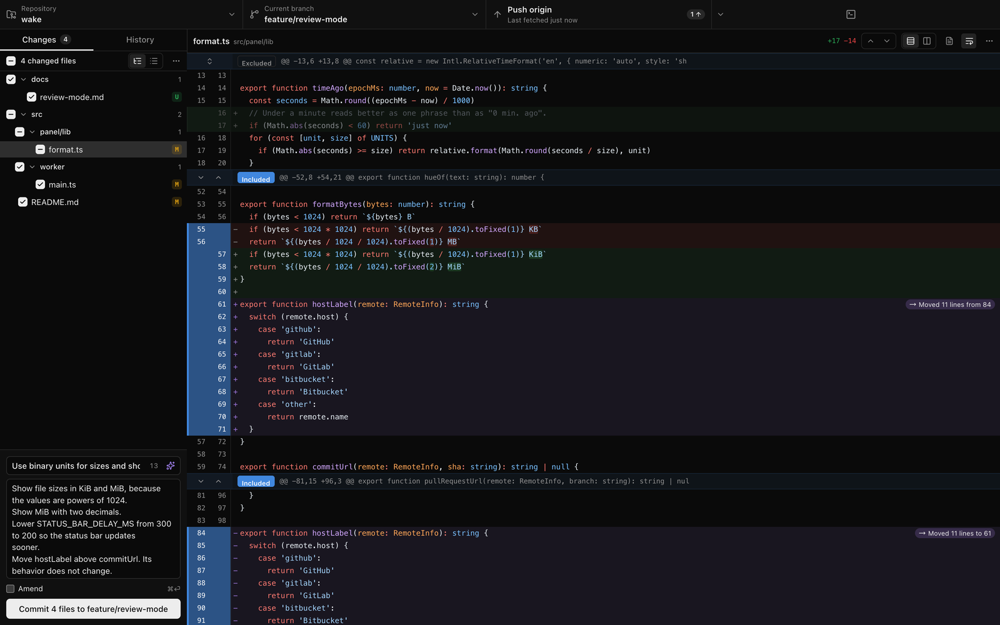
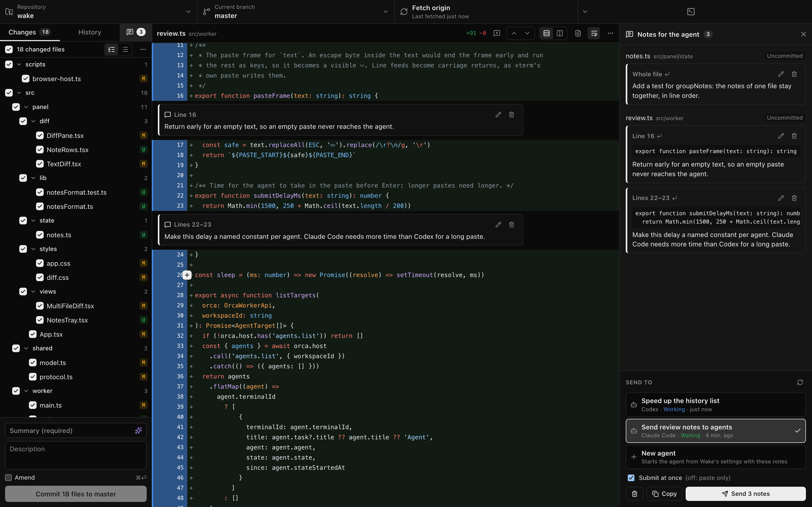
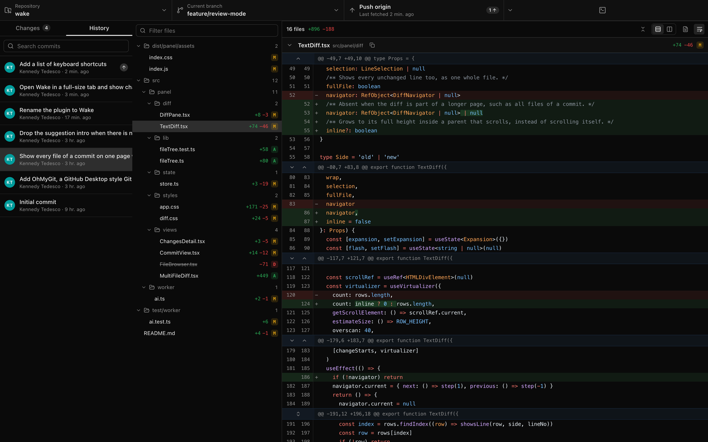
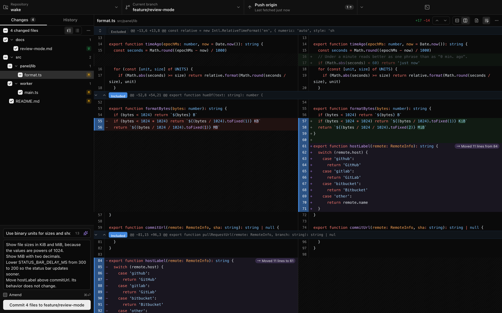
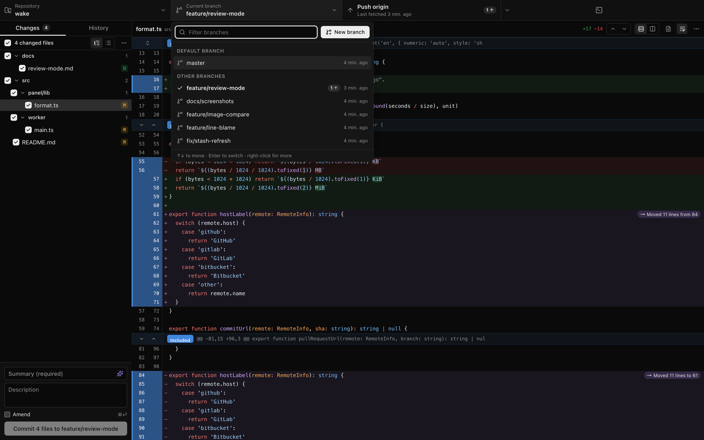
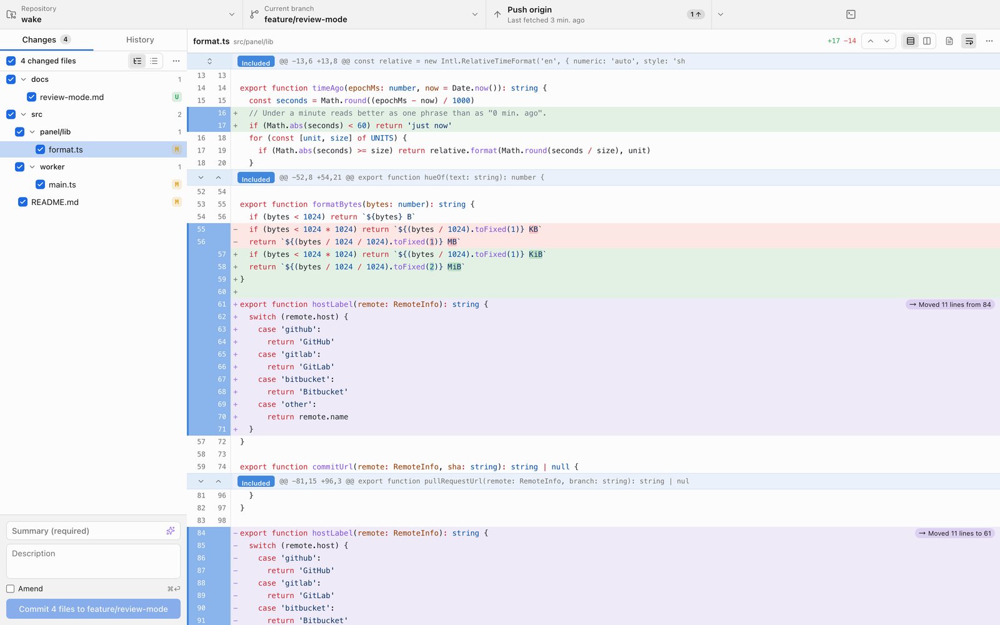

<p align="center"></p>

<h1 align="center">Wake</h1>

<p align="center">A Git panel for <a href="https://orca.dev">Orca</a> that works like GitHub Desktop.</p>

Your agents change a lot of files. Wake shows you what changed, sends your review notes back to the agent, lets you commit exactly the lines you want, and shows the history one commit at a time, without leaving Orca.



## Commit only what you mean

Every changed file is in a folder tree, with a checkbox on each file and each folder. Click a line number to keep that line out of the commit, or drag over several lines. Everything you exclude stays in your working tree for the next commit.

The ✨ button writes the commit message from the lines you kept. It uses the coding agent that you already have: Claude Code, Codex, Gemini CLI or OpenCode. If the commit was a mistake, **Undo** puts it back until you push.

## Send review notes to your agent

Review the agent's work the way you review a pull request. Hover a line in a diff and click **+** to write a note. To note a range, drag the **+** over more lines. To note a whole file, use the note button in the file header. Notes work on your uncommitted changes and on every commit in the history.

Your notes collect in a list next to the **Changes** and **History** tabs. Each note shows its file, its lines and the code on them. You can edit or remove a note there, or click it to go back to the diff. The notes stay until you send them, also when you close Orca.

When you are ready, pick an agent that runs in the workspace and click **Send**. Wake pastes all notes as one prompt, in the format of Orca's own diff notes. For each note, the agent gets the file, the line numbers, the code on those lines and your comment, so it knows where to look. You can also start a new agent with the notes, or copy them as text. Turn off **Submit at once** to add to the prompt before you press Enter.



## Read a commit like a pull request

Open a commit and all of its files are on one page, the way GitHub shows a pull request. The file tree on the left follows your scroll. Click a file to jump to its diff, or type in the filter to find it. A commit with hundreds of files still opens at once, because each diff loads when you scroll near it.

To give the diffs the full width, hide the list of commits with the button next to the **History** tab, or drag its edge to the left. A rail of icons stays at the edge to bring it back. Hide the file tree with the tree button above the diffs. Wake remembers both choices.



## Diffs that are easy to read

- Unified or side by side, with syntax colors for more than 40 languages.
- The words that changed inside a line are marked, not only the line.
- An edited line faces the line that it replaced, also when new lines came in between.
- Code that moved is purple at both ends, with a link from one end to the other, also when it was re-indented.
- Show more lines around a change, or the whole file. Use `n` and `p` to go to the next or previous change.
- Images: compare them side by side, with a swipe, or as an onion skin.



## Branches, pull and push

One menu switches, creates, renames, merges and deletes branches. One button fetches, pulls or pushes, and shows how many commits you are ahead or behind. If a pull stops on a conflict, Wake shows the conflict. You can keep one side, open the file, or mark it as resolved.



## Fits your Orca

Wake takes its colors from your Orca theme, light or dark.



## Install

You need Orca 1.4.260 or later.

```sh
orca plugin install KennedyTedesco/wake
```

Orca shows you what Wake can access before it runs. Wake runs `git` on your computer, so it asks for full access.

## Open Wake

| Where                                   | How                                                               |
| --------------------------------------- | ----------------------------------------------------------------- |
| A full-size tab, next to your terminals | `⌘⇧G`, the Git item in the status bar, or **Wake: Open in a tab** |
| The right sidebar                       | `⌘⌥G`, or **Wake: Show in the sidebar**                           |

In the tab, press `Esc` to go back to your terminal. On Windows and Linux, use `Ctrl` for `⌘` and `Alt` for `⌥`.

Orca opens a tab only for a file. For this, Wake puts a small file named `Wake` at the root of the workspace and tells git to ignore it. You can delete the file at any time.

### From the + menu of the tab bar

Orca does not let a plugin put an icon in the **+** menu yet. Use its search box instead: click **+**, type `Wake`, and press `Enter`. The search finds the `Wake` file and opens Wake in a tab. This works after you open Wake once in the workspace, because that first open creates the file.

## Settings

Open **Settings → Plugins → Wake** in Orca.

| Setting                             | What it does                                                                                                                      |
| ----------------------------------- | --------------------------------------------------------------------------------------------------------------------------------- |
| Fetch automatically every (minutes) | Keeps the ahead and behind counts current. `0` turns it off.                                                                      |
| Coding agent                        | The agent that writes commit messages, and that **New agent** starts for review notes. **Automatic** uses the first one it finds. |
| Model for commit messages           | A model for that agent, such as `haiku`. Empty uses the agent's default.                                                          |
| Commit message instructions         | Your own rules, such as "Use Conventional Commits" or "Write in Portuguese".                                                      |

## Good to know

- Wake works with workspaces on your computer. Workspaces on SSH hosts are not supported yet.
- A plugin cannot show a password prompt. If a push needs your credentials, Wake offers to run the command in a terminal once.

## Contributing

Read [CONTRIBUTING.md](CONTRIBUTING.md) to run Wake from source.

## License

MIT
